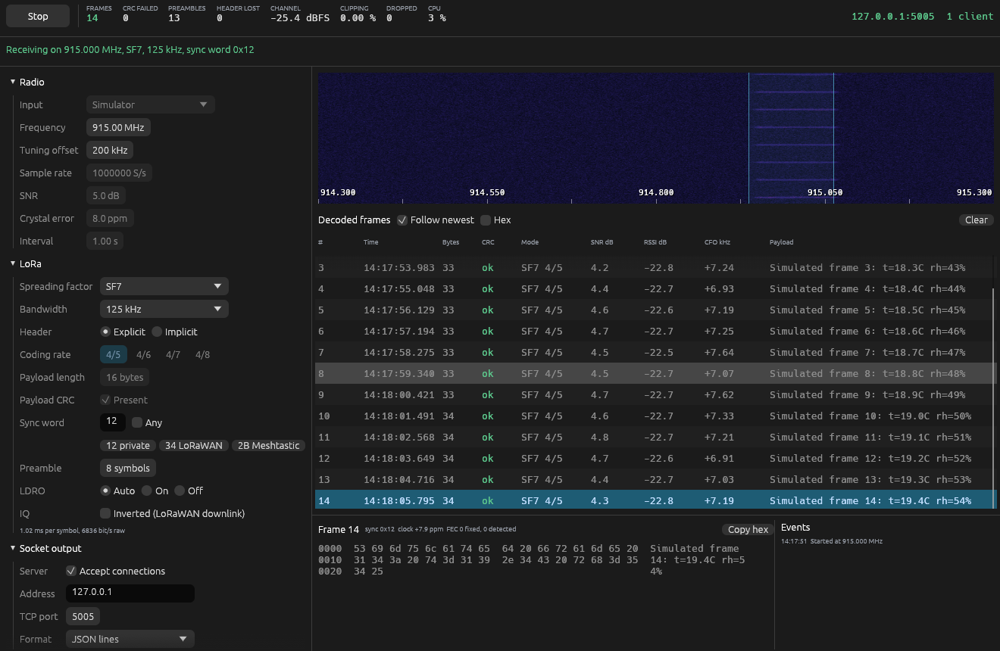

# LoRa RTL-SDR Receiver

A LoRa receiver written in Rust. It decodes LoRa frames from an RTL-SDR dongle,
shows the bytes in a window, and sends them to a TCP socket for your own post
processor. Every LoRa parameter can be changed from the GUI, including while it
is receiving.



## Build and run

You need Rust 1.95 or newer and librtlsdr at run time.

```sh
sudo apt install build-essential librtlsdr0   # Debian, Ubuntu, Raspberry Pi OS
cargo run --release
```

If the build complains about missing system libraries, add
`libgl1-mesa-dev libxkbcommon-dev libwayland-dev`. On macOS use
`brew install librtlsdr`. On Windows put `rtlsdr.dll` beside the executable and
install the WinUSB driver for the dongle with Zadig. So far the program has only
been built and run on Linux.

librtlsdr is loaded when the program starts rather than linked, so no headers are
needed and the file and simulator inputs work without it. Set `LIBRTLSDR_PATH` to
use a library in an unusual place.

**Try it without a radio:** choose *Simulator* as the input and press Start.
Decoded frames appear in the table, and `python3 examples/post_processor.py`
prints them from the socket.

## Using it with a dongle

1. Set **Frequency** to the transmitter's carrier. The default is 915 MHz.
2. Set the **LoRa** section to match the transmitter. If nothing decodes but
   *Preambles* counts up, the spreading factor and bandwidth are right. The Events
   list shows the sync word it saw, or tick *Any*.
3. Press **Start**.

Getting a good signal:

- **Gain:** start around 30 to 40 dB. Watch *Clipping* in the top bar: anything
  above 0 means reduce the gain. Automatic gain suits bursts badly.
- **Tuning offset:** the dongle is tuned this far from the channel and the shift
  is removed digitally, which keeps LoRa clear of the DC spike. 200 kHz suits
  125 kHz LoRa at 1 MS/s. Use more for wider bandwidths.
- **Sample rate:** 1 MS/s is plenty for 125 kHz. For 500 kHz LoRa use 2.4 MS/s
  with an offset of about 500 kHz.
- **Crystal error:** dongles are often tens of ppm out, and the receiver copes
  with this unaided up to about half the bandwidth (roughly 68 ppm at 125 kHz and
  915 MHz, but only 4 ppm at 7.8 kHz). The table's CFO column shows the offset. At
  narrow bandwidths, enter it as a ppm correction.

## Parameters

| Group | Setting | Applies |
|---|---|---|
| LoRa | Spreading factor 5 to 12, bandwidth 7.8 to 500 kHz, sync word or any, preamble length, LDRO auto/on/off, inverted IQ | Live |
| LoRa, implicit header | Coding rate, payload length, CRC present | Live |
| Radio | Frequency, tuning offset, gain, crystal error, bias tee | Live |
| Radio | Device, sample rate, RTL2832 digital AGC | When stopped |
| Socket | Format, include CRC failures | Live, clients stay connected |
| Socket | Address, port | Restarts the server |

With an explicit header the frame carries its own coding rate, length and CRC
flag, so those three controls are greyed out. SF5 and SF6 need implicit header
mode and follow the SX127x convention, which the SX126x does not share.

Settings are saved when the window closes.

## Socket output

The server listens on `127.0.0.1:5005` by default. Use `0.0.0.0` as the address to
accept connections from other machines; there is no authentication, so only do
that on a network you trust. Any number of clients can connect. Each has its own
1024 frame queue, so a client that stalls loses frames rather than delaying the
radio. Frames that fail their CRC are held back unless *Include CRC failures* is
on.

### JSON lines (default)

One object per line:

```json
{"seq":12,"time":"2026-11-04T01:08:50.946Z","freq_hz":915000000,"sf":7,"bw_hz":125000,"cr":"4/7","crc":"ok","sync_word":"0x12","ldro":false,"implicit_header":false,"snr_db":5.9,"rssi_dbfs":-17.3,"cfo_hz":10985.9,"clock_ppm":12.01,"fec_corrected":0,"fec_detected":0,"length":27,"payload_hex":"576561..."}
```

`crc` is `ok`, `bad` or `none`. `rssi_dbfs` is relative to the ADC's full scale, so
it depends on the gain and is not a calibrated dBm figure.

### Hex lines

The payload in lower case hex, one frame per line.

### Raw bytes

Payload bytes only. Nothing marks where one frame ends and the next starts.

### Binary frames

Little endian, one record per frame:

| Offset | Size | Field |
|---|---|---|
| 0 | 4 | `LORA` |
| 4 | 1 | Flags: bit 0 CRC present, bit 1 CRC good |
| 5 | 1 | Spreading factor |
| 6 | 1 | Coding rate, 1 to 4 for 4/5 to 4/8 |
| 7 | 1 | Sync word |
| 8 | 4 | Bandwidth in Hz (`u32`) |
| 12 | 8 | Sequence number (`u64`) |
| 20 | 4 | SNR in dB (`f32`) |
| 24 | 2 | Payload length (`u16`) |
| 26 | n | Payload |

## Analysing LoRaWAN in Wireshark

`examples/lorawan_to_pcap.py` connects to the socket (JSON lines format) and turns
each frame into a pcap record with a LoRaTap header. Wireshark's LoRaTap
dissector then hands frames with sync word 0x34 to its LoRaWAN dissector.

```sh
python3 examples/lorawan_to_pcap.py | wireshark -k -i -        # live
python3 examples/lorawan_to_pcap.py -w lorawan.pcap            # to a file
lora-decode capture.cu8 --sync 0x34 --offset 200000 | python3 examples/lorawan_to_pcap.py --stdin -w out.pcap
```

Set the sync word to 34 in the receiver. Without keys Wireshark shows the
headers: message type, device address, frame counter and port. To decrypt
payloads and check MICs, enter keys under Preferences, Protocols, LoRaWAN:
*Session keys* (device address, NwkSKey, AppSKey) for data frames and *Root keys*
(DevEUI, AppKey) for joins. LoRaTap's RSSI fields show -139 dBm because the
receiver has no calibrated RSSI to give; SNR is filled in.

Tested with Wireshark 4.2: uplinks and join requests built with known keys went
through `lora-gen`, `lora-decode` and the bridge, and Wireshark decrypted them and
reported their MICs as correct.

## Command line tools

`lora-decode` applies the same receive chain to a recording and prints JSON lines:

```sh
rtl_sdr -f 914800000 -s 1000000 -g 40 capture.cu8
cargo run --release --bin lora-decode -- capture.cu8 --offset 200000 --sf 7 --stats
```

`lora-gen` writes a test recording with noise and a crystal error. `--hex` sends
exact payload bytes, such as a LoRaWAN frame. Run either with
`--help` for the options. The GUI replays cu8, cs8, cs16 and cf32 files.

## How it works

Samples are mixed down by the tuning offset, filtered, and resampled to 4 times
the LoRa bandwidth. The channel filter is deliberately wider than the signal so
that a carrier offset does not cut off part of each chirp.

The decoder looks for a tone that stays in one FFT bin across several symbols,
then follows the preamble to the downchirps. An up-chirp's peak falls at
`cfo + timing` and a down-chirp's at `cfo - timing`, which separates the two. Once
the carrier offset is known it is removed and a second, narrow filter keeps the
noise out before each symbol's FFT.

The sample clock error comes from the carrier offset, because a crystal clocks
both the radio and the ADC: `error = cfo / carrier`. This matters. At 20 ppm,
a long SF12 frame would otherwise slip by many bins. A tracking loop follows any
remaining drift from where each FFT peak lands.

## Testing

```sh
cargo test --release       # 27 tests, a few seconds
sh tools/check_rtlsdr.sh   # needs librtlsdr-dev, exercises the radio path
```

- **Coding chain:** 1760 vectors from
  [gr-lora_sdr](https://github.com/tapparelj/gr-lora_sdr), an independent
  implementation tested with SX1276, RFM95 and SX1262 radios, match symbol for
  symbol across SF5 to SF12, all coding rates, LDRO, header modes and CRC settings.
- **Receive chain:** decodes signals generated by gr-lora_sdr, and in simulation
  handles every bandwidth, 40 ppm clock errors, carrier drift, 255 byte payloads,
  and a dongle's 8 bit samples, DC offset, IQ imbalance and spurs.
- **Sensitivity:** on identical noisy signals from gr-lora_sdr's transmitter, this
  decoder matched or beat gr-lora_sdr's own receiver at every point measured from
  SF7 to SF10 (`tools/compare_rx.py`), with 30 frames per point. Its receiver
  produced no frames in this test at SF11 and SF12, so those have no comparison;
  this decoder got 14 of 16 frames at SF11 and -19 dB, and 11 of 12 at SF12 and
  -21 dB.
- **Radio path:** `tools/fake_rtlsdr.c` compiles against the real `rtl-sdr.h` and
  plays a recording through the real API, covering configuration, the asynchronous
  callback, live retuning and stopping.
- **Socket:** real TCP clients in all four formats, including a stalled client.

**Not yet tested:** a physical dongle, and signals captured from a physical LoRa
radio. Everything above is short of that last step, so a first run on real
hardware may need some tuning.

## Limitations

- One spreading factor and bandwidth at a time. A LoRaWAN gateway listens to all
  of them at once; this does not.
- One frame at a time. A frame arriving during another is missed, even at a
  different spreading factor.
- Hard decisions only. Soft decoding would gain a little at the sensitivity limit.
- SF5 and SF6 on SX126x radios are not supported, as noted above.

## Troubleshooting

**"could not open dongle" on Linux.** The DVB television driver has probably
claimed it:

```sh
echo 'blacklist dvb_usb_rtl28xxu' | sudo tee /etc/modprobe.d/blacklist-rtlsdr.conf
sudo rmmod dvb_usb_rtl28xxu
```

**Permission errors.** Install the udev rules, which come with the `rtl-sdr`
package, then replug the dongle.

**Dropped samples.** The top bar counts samples lost when processing falls behind.
Lower the sample rate, or use a better USB port. Rates above 2.4 MS/s are often
unreliable on these dongles.

**Header lost keeps counting.** The signal is weak or the bandwidth is wrong. Check
the SNR column, and check for clipping.

## Licence

GPL-3.0-or-later, the same as gr-lora_sdr, whose reverse engineering of the coding
chain this project follows.
